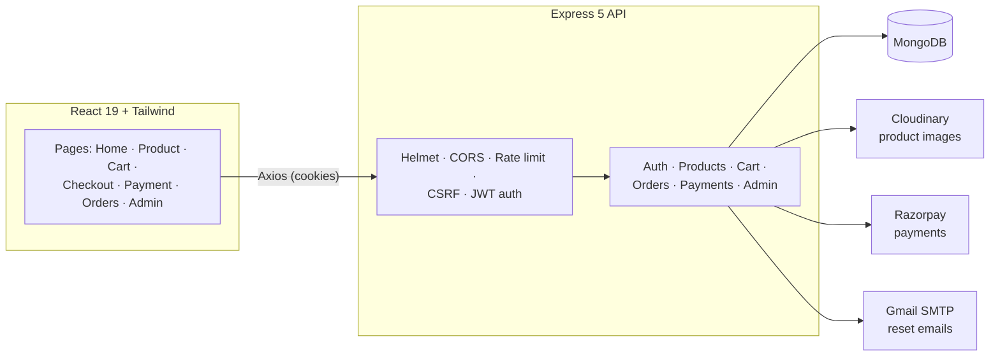
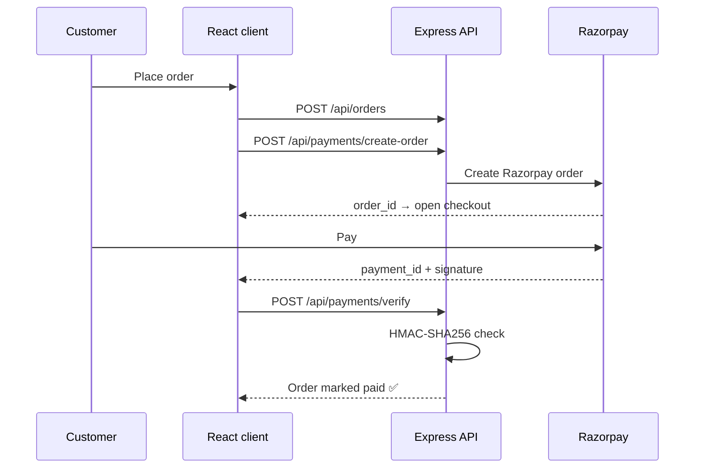

# 🛒 MERN E-Commerce
[](https://github.com/JayantBansal900/ecommerce-mern/actions/workflows/ci.yml)

A full-stack online store built on the **MERN stack**. Customers can browse products, manage a cart, check out and **pay through Razorpay**. Admins manage the catalogue, process orders and track revenue on an analytics dashboard.

Security got serious attention: **access/refresh JWTs in HttpOnly cookies, CSRF protection, Helmet, rate limiting and server-side payment signature verification**.


> 📸 _Screenshots coming soon: add images to `docs/` and link them here._

---

## Features

### 🛍️ Customers
- Register, log in and log out, with **forgot / reset password by email**
- Browse products and view product details
- Persistent cart: add, update quantity, remove items
- Checkout with shipping address
- **Razorpay payments**, verified on the server
- Order history, order details and order cancellation

### 🛠️ Admins
- Create products with **image upload to Cloudinary**; edit and delete products
- View all orders, update order status, mark orders as paid
- **Analytics dashboard**: total revenue and **monthly revenue charts** (MongoDB aggregation + Chart.js / Recharts)

### 🔐 Security
| Concern | How it's handled |
|---|---|
| Authentication | Short-lived **access token (15 min)** + **refresh token (7 days)**, both in **HttpOnly cookies** |
| Passwords | Hashed with **bcrypt** |
| Authorisation | `protect` and `adminOnly` middleware (role-based access control) |
| CSRF | `csurf` token on state-changing requests |
| Brute force | Global rate limit (100 req / 15 min) and **login limit (5 attempts / 15 min)** |
| HTTP headers | **Helmet** |
| Payments | Razorpay signature checked with **HMAC-SHA256** before an order is marked paid |
| Password reset | Random token, stored **hashed (SHA-256)** with an expiry time |
| Inventory | Stock is checked and decremented when ordering and **restored on cancellation** |

## Architecture



### Payment flow



## API overview

| Area | Endpoints |
|---|---|
| **Auth** `/api/auth` | `POST /register` · `POST /login` · `POST /refresh` · `POST /logout` · `POST /forgot-password` · `PUT /reset-password/:token` · `GET /profile` |
| **Products** `/api/products` | `GET /` · `GET /:id` · `POST /` 🔒admin (multipart image) · `PUT /:id` 🔒admin · `DELETE /:id` 🔒admin |
| **Cart** `/api/cart` | `GET /` · `POST /` · `DELETE /:productId` (all 🔒) |
| **Orders** `/api/orders` | `POST /` · `GET /myorders` · `GET /:id` · `PUT /:id/cancel` · `GET /` 🔒admin · `PUT /:id/status` 🔒admin · `PUT /:id/pay` 🔒admin |
| **Payments** `/api/payments` | `POST /create-order` · `POST /verify` (🔒) |
| **Admin** `/api/admin` | `GET /stats` · `GET /monthly-revenue` (🔒admin) |

## Data model

| Collection | Key fields |
|---|---|
| **User** | name, email, password (hashed), role (`user` / `admin`), reset token + expiry |
| **Product** | name, description, price, category, stock, image (Cloudinary URL) |
| **Cart** | user, items `[{ product, quantity }]` |
| **Order** | user, items, shippingAddress, totalPrice, isPaid, paidAt, orderStatus |

## Project structure

```
ecommerce-mern/
├── client/                 # React 19 (Create React App) + Tailwind
│   └── src/
│       ├── api/axios.js    # Axios instance (credentials + CSRF)
│       ├── context/        # AuthContext
│       ├── components/     # Navbar
│       └── pages/          # 13 pages incl. admin dashboard & orders
└── server/                 # Express 5 API
    ├── config/             # Cloudinary, Razorpay
    ├── controllers/        # auth, product, cart, order, payment, admin
    ├── middleware/         # auth, upload (multer), async + error handlers
    ├── models/             # User, Product, Cart, Order
    ├── routes/
    ├── utils/sendEmail.js  # Nodemailer
    └── server.js
```

## Run it locally

**Prerequisites:** Node.js 18+, a MongoDB database, and free accounts for [Razorpay](https://razorpay.com) (test mode) and [Cloudinary](https://cloudinary.com).

```bash
git clone https://github.com/JayantBansal900/ecommerce-mern.git
cd ecommerce-mern
```

Copy the example file to `server/.env` and fill in your own values:

```bash
cp server/.env.example server/.env
```

It contains:

```env
PORT=5000
MONGO_URI=mongodb+srv://<user>:<password>@<cluster>/ecommerce
JWT_SECRET=your_jwt_secret

RAZORPAY_KEY_ID=rzp_test_xxxxxxxx
RAZORPAY_KEY_SECRET=your_razorpay_secret

CLOUDINARY_CLOUD_NAME=your_cloud_name
CLOUDINARY_API_KEY=your_api_key
CLOUDINARY_API_SECRET=your_api_secret

# Gmail address + App Password, used for password-reset emails
EMAIL_USER=you@gmail.com
EMAIL_PASS=your_app_password
```

Start the API (terminal 1):

```bash
cd server
npm install
node server.js        # http://localhost:5000
```

Start the React app (terminal 2):

```bash
cd client
npm install
npm start             # http://localhost:3000
```

To get an admin account, register normally, then set that user's `role` to `"admin"` in MongoDB.

## Roadmap

- [ ] Product search, category filters and pagination
- [ ] Product reviews and ratings
- [ ] Automated tests (Jest + Supertest) and CI
- [ ] Deployment (Vercel + Render) with environment-based CORS and secure cookies
- [ ] Docker Compose for one-command setup

## Author

**Jayant Bansal** · [GitHub](https://github.com/JayantBansal900)
